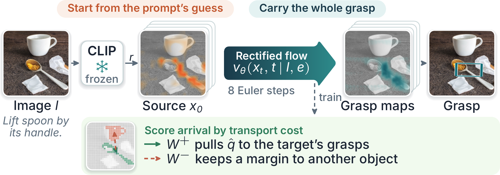

<div align="center">

# GRAT: Grounding as Transport

**Carrying the whole grasp from the prompt's guess to the target**

[](LICENSE)
[](https://www.python.org/)
[](https://pytorch.org/)
[](https://airvlab.github.io/grasp-anything/)



<sub>GRAT on a Grasp-Anything image with GG-CNN. The maps and the grasp are real outputs; the OT panel is illustrative.</sub>

</div>

Language-driven grasp detection predicts a grasp on the object part named by an instruction, such as *"Lift spoon by its handle."*
This repository holds the code of our 2-page CVPR-format paper.

## The idea

A frozen vision-language model already gives a coarse estimate of the location: its dense image-text relevance map. Existing
detectors ignore it, regressing grasps directly or denoising them from Gaussian noise. GRAT treats grounding as the **correction**
of this estimate.

- **Start from the prompt's guess.** The source of the flow comes from the CLIP relevance map, not from noise.
- **Carry the whole grasp.** One rectified flow transports all four grasp maps: quality, cos 2θ, sin 2θ and width.
- **Score arrival by transport cost.** An optimal-transport loss pulls the predicted grasp mass to the referred object and keeps a
  margin to another object.

GRAT is a light module: 13K extra trainable parameters on GR-ConvNet and GG-CNN, 70K on CROG. It keeps each pipeline's network design,
decoder and training budget, and adds a frozen CLIP ViT-B/16 for the relevance map.

## Results

Test success on Grasp-Anything++, with every method re-trained under one protocol. Values are the mean of seeds 123, 456 and 789,
with the standard deviation of H. H is the harmonic mean of seen and unseen success.

| Pipeline | Method | Seen | Unseen | H | ΔH |
|:---|:---|:---:|:---:|:---:|:---:|
| **GR-ConvNet** | baseline | 0.301 | 0.344 | 0.320 ± 0.011 | |
| | + GRAT | **0.489** | **0.431** | **0.458 ± 0.027** | **+0.138** |
| **GG-CNN** | baseline | 0.279 | 0.257 | 0.267 ± 0.014 | |
| | + GRAT | **0.471** | **0.424** | **0.446 ± 0.010** | **+0.179** |
| **CROG** | baseline | **0.470** | **0.362** | **0.406 ± 0.054** | |
| | + GRAT | 0.380 | 0.360 | 0.369 ± 0.028 | −0.037 |

GRAT helps pipelines without spatial language grounding on every seed. It does not help CROG, which already grounds the instruction
by word-pixel fusion.

**Ablations.** Without the OT loss, CNN validation success stays below 0.1 in 84–97% of epochs, and two-seed test H falls to 0.273,
0.237 and 0.231 on GR-ConvNet, GG-CNN and CROG. On GG-CNN, a constant pose source collapses validation success within five epochs.

## Quick start

```bash
git clone --recursive https://github.com/gracebml/grasp-hw-project
cd grasp-hw-project
```

Install the environment and prepare the data ([below](#setup)), then:

```bash
# Train GRAT. NETWORK = lgrconvnet3 (GR-ConvNet + CLIP) | lggcnn (GG-CNN + CLIP) | crog
GRAT=1 NETWORK=lggcnn SEED=123 DATA_ROOT=/path/to/data python experiments/train.py

# Test with the official evaluate.py. The checkpoint with the best validation success is picked from the run's log
CKPT_DIR=outputs/local/<run> SPLIT_LIST=ref_sources/LGD/split/grasp-anything++/test/seen.obj \
  DATA_ROOT=/path/to/data python experiments/evaluate.py          # add MODEL=crog for CROG
```

Every run in the table used 50 epochs of 1,000 batches of 8 on one GPU (A100 or V100). Parameters are environment variables, listed at
the top of each script.

<details>
<summary><b>Baselines, ablations and constants</b></summary>

```bash
# Baseline
NETWORK=lggcnn DATA_ROOT=/path/to/data python experiments/train.py

# Ablation: without the OT loss
GRAT=1 OT=0 NETWORK=lggcnn DATA_ROOT=/path/to/data python experiments/train.py

# Ablation: constant pose source
GRAT=1 SOURCE=constant NETWORK=lggcnn DATA_ROOT=/path/to/data python experiments/train.py

# Measure the constants of GRAT, the pose prior and lambda. The measured values are the defaults in grat.py
DATA_ROOT=/path/to/data python experiments/calibrate.py
```

</details>

## Checkpoints

The checkpoints behind the paper, one per seed at the epoch with the best validation success, are on
**[Google Drive](https://drive.google.com/drive/folders/1aUMKJUh7hmqDJhTZq2sXdwBfQGMCBBs0?usp=sharing)**. Put them under `checkpoints/`:

```
checkpoints/
├── baseline/     {lgrconvnet3, lggcnn, crog}_s{123, 456, 789}/
├── grat/         {lgrconvnet3, lggcnn, crog}_s{123, 456, 789}/
└── grat_no_ot/   {lgrconvnet3, lggcnn, crog}_s{123, 456}/
```

Each run has its own folder, so it goes straight to `evaluate.py`:

```bash
CKPT_DIR=checkpoints/grat/lggcnn_s123 SPLIT_LIST=ref_sources/LGD/split/grasp-anything++/test/seen.obj \
  DATA_ROOT=/path/to/data python experiments/evaluate.py
```

Counts can differ by a few samples across GPU models: on this checkpoint test/seen gives 665/1376 on an A100, the card behind the
table, and 667/1376 on a V100, with the same code.

## Where the method lives

| In the paper | In the code |
|:---|:---|
| Source x₀, path x_t, velocity loss, Euler inference | [`src/lgdbench/grat.py`](src/lgdbench/grat.py) |
| Relevance map r (MaskCLIP-style CLIP ViT-B/16) | [`src/lgdbench/relevance.py`](src/lgdbench/relevance.py) |
| Sinkhorn distance, pull term and margin | [`src/lgdbench/ot.py`](src/lgdbench/ot.py) |
| Pose prior and the rule for λ | [`experiments/calibrate.py`](experiments/calibrate.py) |
| Integration into each pipeline | `GRATConvNet`, `GRATGGCNN`, `GRATCROG` in `grat.py` |

```
├── src/lgdbench/   the method, and adapters to the official code
├── experiments/    train, evaluate, calibrate, data preparation
├── tests/          unit tests
├── data_index/     fixed key lists of the internal explore subset, cut from train/seen.obj
├── ref_sources/    official LGD and CROG code (git submodules, read-only)
└── assets/         figures of this page
```

## Setup

**Environment.** Python 3.9 with the versions of the official `requirements.txt`:

```bash
pip install torch==1.12.1+cu113 torchvision==0.13.1+cu113 --extra-index-url https://download.pytorch.org/whl/cu113
pip install "numpy<1.24" -r ref_sources/LGD/requirements.txt   # the official code uses np.int / np.float
pip install --no-deps loguru==0.7.0 lmdb==1.4.1 pyarrow==10.0.0 shapely==2.0.1   # CROG extras
pip install -e .
```

`inplace-abn`, in the official requirements, needs `nvcc` to build. Only Det-Seg-Refine uses it, and we do not run that method. CLIP
downloads itself; CROG needs OpenAI's `RN50.pt`, with its path in `CLIP_RN50`.

<details>
<summary><b>Data</b></summary>

<br>

Grasp-Anything++ ships annotations only; the images come from Grasp-Anything.

| File | Hugging Face repo | sha256 | Used for |
|:---|:---|:---|:---|
| `image_part_aa`, `image_part_ab` (→ `image.zip`) | `airvlab/Grasp-Anything` | `dddedff9…11ce`, `ecfd2a39…e4c1` | images |
| `scene_description.zip` | `airvlab/Grasp-Anything` | `357b2688…452b` | scene description, read by the official loader |
| `grasp_label_positive.zip` | `airvlab/Grasp-Anything-pp` | `3a43236f…fd4f` | grasp labels |
| `grasp_instructions.zip` | `airvlab/Grasp-Anything-pp` | `afd0b539…9a6a` | text input |
| `mask.zip` | `airvlab/Grasp-Anything` | `dcb8b99f…ddc5` | CROG training only |

Expected layout of `DATA_ROOT`:

```
DATA_ROOT/grasp-anything/image/<scene>.jpg
DATA_ROOT/grasp-anything/prompt/<scene>.pkl
DATA_ROOT/grasp-anything/mask/<scene>_<obj>.npy                 # CROG training keys only
DATA_ROOT/grasp-anything++/positive_grasp/<scene>_<obj>_<part>.pt
DATA_ROOT/grasp-anything++/grasp_instructions/<scene>_<obj>_<part>.pkl
```

The archives hold millions of small files, so only the needed keys are extracted:

```bash
python experiments/make_split_subset.py <full_root> <subset_root>                             # images, scene descriptions, labels
python experiments/extract_annotations.py instructions grasp_instructions.zip <subset_root>   # one per label file
python experiments/extract_annotations.py masks mask.zip <subset_root>                        # CROG training keys only
```

</details>

<details>
<summary><b>Protocol and changes to the official pipeline</b></summary>

<br>

| | |
|:---|:---|
| Input | RGB image (416×416 resized to 224) and the GA++ grasp instruction. No depth |
| Data | `train/seen` (28,621 instructions, 90/10 train/validation), `test/seen` (1,376), `test/unseen` (601) |
| Budget | 50 epochs of 1,000 batches of 8, each method with its own optimizer, seeds 123, 456, 789 |
| Metric | Top-1 success: IoU > 0.25 and angle error ≤ 30° (code of LGD); seen, unseen and their harmonic mean |

All metric code and the training loop are **imported from the official LGD repository, not re-implemented**. The changes:

| Change | Why |
|:---|:---|
| Train on `train/seen.obj`, test on the full `test/*` lists | the released loader only reads `test/*` |
| Drop `.detach()` on the image features of GR-ConvNet + CLIP and GG-CNN + CLIP | the image encoder otherwise never trains |
| CROG as third baseline, through an adapter | released method with real language grounding |
| Image augmentation and validation scoring on the GPU | speed; checked equal to the official CPU code |
| Text = GA++ grasp instruction instead of the object name | the task defines the input as the grasp prompt |
| Checkpoint chosen on non-augmented validation | the official validation shares the augmented dataset |

The official repositories are pinned submodules: [LGD](https://github.com/Fsoft-AIC/LGD) @ `501904d` and
[CROG](https://github.com/HilbertXu/CROG) @ `1eeee85`. Every change lives in `src/lgdbench/`, and `tests/test_refs.py` checks that both
sit at the pinned commit with no local edit. The tests of GRAT need OpenAI CLIP installed; run everything with `pytest`.

</details>

## Acknowledgements

Built on the official code of [LGD](https://github.com/Fsoft-AIC/LGD) and [CROG](https://github.com/HilbertXu/CROG), and on the
[Grasp-Anything](https://airvlab.github.io/grasp-anything/) datasets.

## License

The code in this repository is under the [MIT License](LICENSE). `ref_sources/` holds git submodules, not copies: LGD and CROG stay at
their own repositories under their own MIT licenses. Adapted code is credited in [THIRD_PARTY_NOTICES.md](THIRD_PARTY_NOTICES.md).
